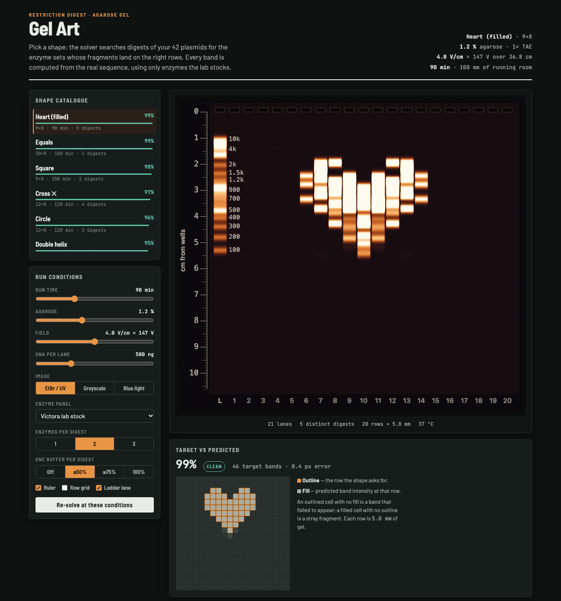
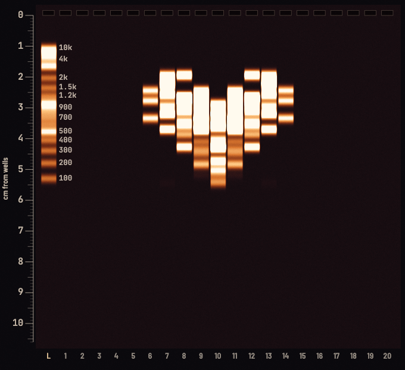
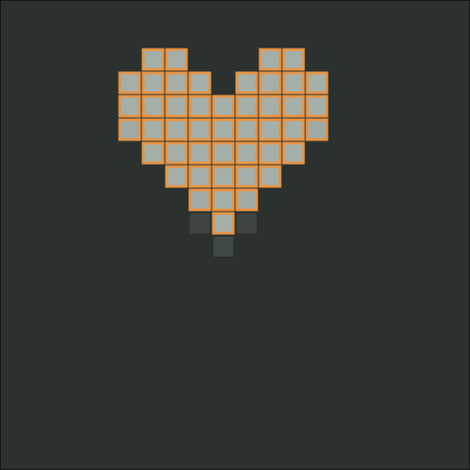
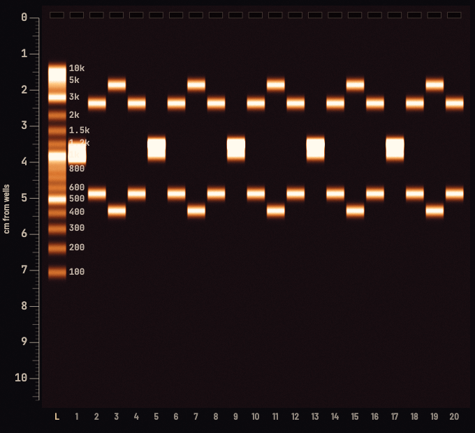
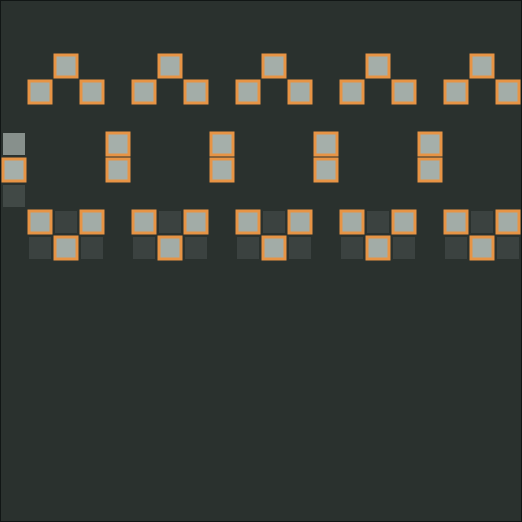
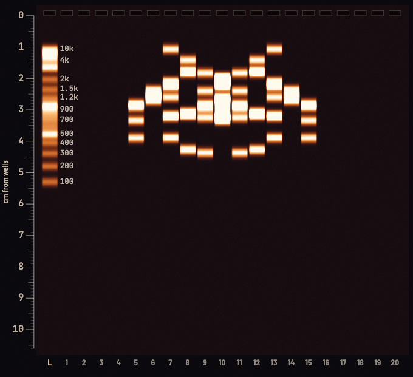
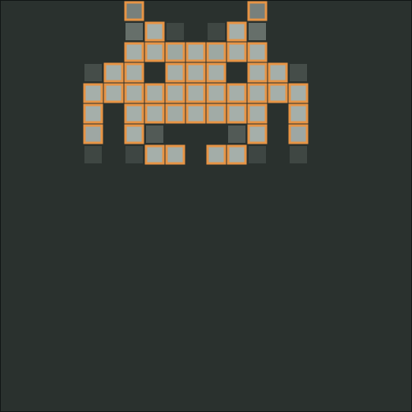
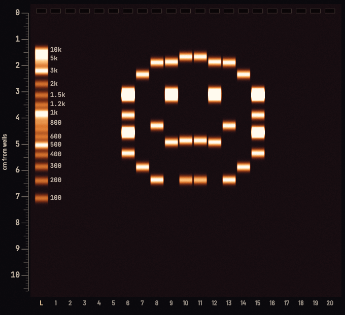

# gelart

Creates a DNA digestion plan to create shapes and drawings in an agarose gel.

Pick a shape (a heart, a smiley, a wave…). Gel Art searches restriction digests of the plasmids you
give it for the enzyme sets whose fragments land on the right rows, then shows the predicted gel, the
recipe for each lane, and a digest plan you can take to the bench. Every band is computed from the real
sequence, using only enzymes you have on hand.

It is a static page plus a small JavaScript engine: no build step, no server.

## Run it

Open `gelart.html` in a browser. Nothing else is needed (the page asks Google Fonts for its typefaces
and falls back to system fonts offline).

The page you get from this repository is a **demo**: its catalogue is solved over only pUC19
(L09137.2) and pBR322 (J01749.1). Those two plasmids cannot place every shape well — the best match
for each of the 16 shapes in the demo catalogue scores 32 to 71 %. More, and more varied, plasmids widen
the set of fragment sizes the solver can choose from, and that is what makes smooth shapes reachable.
See below to use your own.

## Examples

These images were rendered from the Victora lab's own catalogue of 42 plasmids, to show what the tool
can do with a larger, more varied set. That catalogue is unpublished and is not in this repository. A fresh clone
ships only pUC19 and pBR322, which reach 32 to 71 % on the same shapes; the images from that
demo catalogue are in [`docs/img/demo/`](docs/img/demo).

Conditions: 1.2 % agarose in 1x TAE, 4 V/cm (147 V across a 36.8 cm electrode gap), at most two enzymes
per digest from the lab stock, one buffer carrying every enzyme at ≥ 50 %, EtBr / UV rendering. The page
follows your system colour scheme; these were rendered in dark mode.



Each cell below shows the predicted gel, and under it the target against the prediction: an outlined
cell is a row the shape asks for, and a filled cell is the band intensity the digest actually puts
there. The percentage is the solver's match score, and the verdict is the page's own wording.

<table>
  <tr>
    <th>Heart (filled), 9 × 8 grid, 90 min, 5 digests<br>99 % — clean</th>
    <th>Double helix, 20 × 8 grid, 120 min, 4 digests<br>95 % — clean</th>
  </tr>
  <tr>
    <td><br></td>
    <td><br></td>
  </tr>
  <tr>
    <th>Invader, 11 × 8 grid, 90 min, 6 digests<br>93 % — clean</th>
    <th>Smiley, 10 × 10 grid, 120 min, 5 digests<br>85 % — readable</th>
  </tr>
  <tr>
    <td><br></td>
    <td><br></td>
  </tr>
</table>

All 16 shapes score 85 % or better on this catalogue (Heart (filled) and Equals at 99 %, Smiley at 85 %); the
page rates 13 of them "clean" and 3 "readable". These are predictions from an uncalibrated model, not
photographs of gels.

## What you can set

| Control | What it does |
| --- | --- |
| Shape catalogue | 16 shapes: Arrow up, Chevron, Circle, Cross, Diagonal, Diamond, Double helix, Equals, Heart, Heart (filled), House, Invader, Smiley, Square, Triangle, Wave |
| Run time, agarose %, field (V/cm), DNA per lane | The run conditions the band positions and intensities are predicted for. Defaults: 1.2 % agarose in 1x TAE, 4 V/cm, 20 lanes, 36.8 cm electrode gap |
| Image | EtBr / UV, greyscale, or blue light rendering |
| Enzyme panel | The Victora lab stock, every enzyme in the table, 6+ bp and degenerate, 6+ bp cutters only, 4–5 bp frequent cutters, or your own stock list |
| Enzymes per digest | 1, 2 or 3 |
| One buffer per digest | Off, or require one NEB buffer (r1.1, r2.1, r3.1, rCutSmart) to carry every enzyme at ≥ 50 %, ≥ 75 % or 100 % activity |

Outputs: target vs predicted gel, lane recipes, and a digest plan that groups lanes sharing a plasmid and
enzyme set into one reaction (10 U per µg, NEB's convention for supercoiled plasmid).

Buffer activity is parsed from NEB's *Performance Chart for Restriction Enzymes* (2025); no value is
inferred. The enzyme table is in `src/core.js`; the buffer table is `src/buffers.js`.

## Use your own plasmids

`gelart.html` loads `src/data.js` and then, if it exists, `src/data.local.js`. The second file overrides
the first, and is listed in `.gitignore` so a private catalogue never gets committed. Both files
assign the same global:

```js
window.GELART_DATA = {
  catalog: { /* precomputed shape solutions, see below */ },
  seqs: [ { name: 'pUC19', seq: 'TCGCGC…', circular: true, acc: 'L09137.2' }, … ]
};
```

To build one, put your sequences in `data/plasmiddb.json` (an array of `{name, seq, circular}`),
add `data/pUC19_L09137.fa` and `data/pBR322_J01749.fa` (GenBank L09137.2 and J01749.1) if you want them
too, and run the catalogue step with any JavaScript shell (on macOS, `jsc`):

```sh
JSC=/System/Library/Frameworks/JavaScriptCore.framework/Versions/A/Helpers/jsc
$JSC src/core.js src/precompute_db.js > catalog.json
```

then wrap `catalog.json` and the matching `seqs` list as above and save it as `src/data.local.js`.
The wrapping step is not scripted in this repository. The solve is combinatorial: about 16 s for 42
plasmids with at most two enzymes per digest.

`data/` is not shipped, so `precompute.js`, `precompute_db.js` and three of the four test files cannot run from a
fresh clone until you add it.

## The migration model is not calibrated to your gel yet

Band *sizes* are exact, since they come from the sequence. The step from a fragment size to a position
on the gel runs through a Van Winkle mobility model for TAE with literature constants, which belong
to somebody else's tank. In the rig it was written for, the run times it predicts disagree with the real run
sheets by about twofold. Treat the shapes as achievable and the clock as provisional.

`calibration/` replaces the literature constants with measured ones for one rig, one buffer and one
agarose percentage, and also measures the faintest band your imager can see.

1. Edit `CONFIG` at the top of `calibration/calibrate.js` to match the rig (electrode gap, V/cm,
   agarose %, ladder).
2. Generate the bench sheet (this overwrites `calibration/measurements.csv`, so do it before you
   start filling one in):
   `$JSC src/core.js calibration/calibrate.js -- template > calibration/measurements.csv`
3. Run a gel and photograph it at a fixed interval, 5 or 6 photos across the run, stopping on the
   ladder. Measure each band's distance from the well in the `mm` column and put the power-on
   minutes in `t_min`. The full procedure, including the dilution series for the detection floor, is
   in [`Gel migration calibration protocol.md`](Gel%20migration%20calibration%20protocol.md)
   ([HTML version](Gel_migration_calibration_protocol.html)).
4. Fit it:
   `$JSC src/core.js calibration/calibrate.js -- fit calibration/measurements.csv`
   prints the fit, a drift diagnostic, outliers, and the lane-to-lane smiling.

`calibration/measurements.csv` is the blank bench sheet for the lab rig (1.2 % TAE, 4 V/cm, NEB 1 kb
Plus ladder) and has no measurements in it yet. `measurements_SIMULATED.csv` is made-up data to show what
the fit output looks like. A fit needs at least 12 measured bands, and ideally 40 or more.

## Layout

```
gelart.html            the app (single page)
src/core.js            enzyme table, digest engine, migration model, lane solver; no DOM
src/buffers.js         NEB buffer activity table
src/render.js          gel rendering
src/data.js            demo catalogue and sequences (pUC19, pBR322)
src/precompute*.js     build a catalogue (need data/, not shipped)
calibration/           bench sheet generator + fitter, measurement sheets
docs/img/              screenshots used in this README (docs/img/demo/ = the shipped demo catalogue)
LICENSE                MIT
test/                  run with: jsc src/core.js test/<file>.js
```

`test/test_calib.js` runs from a plain clone (`$JSC src/core.js test/test_calib.js`). The others read
files from `data/`. The engine has no dependencies and no DOM, so it runs in a browser or any JS shell.

## License

MIT; see [LICENSE](LICENSE).
